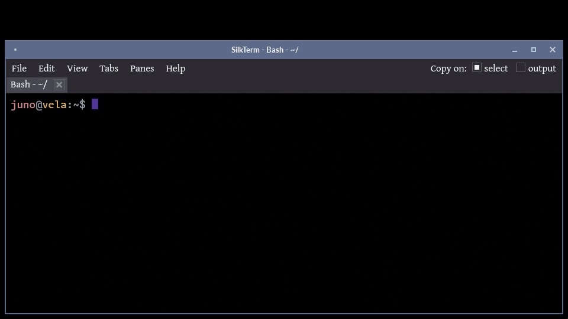

<!-- markdownlint-disable MD007 -- Unordered list indentation -->
<!-- markdownlint-disable MD010 -- No hard tabs -->
<!-- markdownlint-disable MD033 -- No inline html -->
<!-- markdownlint-disable MD055 -- Table pipe style [Expected: leading_and_trailing; Actual: leading_only; Missing trailing pipe] -->
<!-- markdownlint-disable MD041 -- First line in a file should be a top-level heading -->

<!--

-->

<!-- TOC ignore:true -->
# SilkTerm

<!-- Full demo video with sound: [SilkTerm on YouTube](https://www.youtube.com/watch?v=TODO) -->

SilkTerm™ is a hardware-accelerated terminal for Linux, Windows and macOS that scrolls new output smoothly, a pixel at a time, instead of jumping whole lines. Fast output isn't held back; the scroll speeds up to keep pace. It also has an animated cursor, a text halo that keeps text readable over a wallpaper or a see-through window, a scrollback minimap, tabs and split panes. One executable, written in Rust.

<!--
<table style="border: none; border-collapse: collapse;">
	<tr style="border: none; border-collapse: collapse;">
		<td style="border: none; border-collapse: collapse;"></td>
		<td style="border: none;">SilkTerm is the only known terminal currently in existence, that smooth-scrolls lines on output - for silky-smooth and less-tiring long terminal sessions. It also has smooth cursor options such as phase effect for blinking, and smooth movement.  SilkTerm also has multiple tabs, split-panes, transparency and blur, background image and blur, text scrim, and can run without a menu and/or window decorations.  Cross-platform. Written in Rust for a small single executable, and blazing speed.</td>
	</tr style="border: none; border-collapse: collapse;">
</table>
-->

<!-- TOC ignore:true -->
## Table of contents

<!-- TOC -->

- [Why?](#why)
	- [Why smooth-scrolling output](#why-smooth-scrolling-output)
	- [Why text scrim](#why-text-scrim)
- [Features](#features)
- [Wallpaper pack](#wallpaper-pack)
- [Terminal showdown - speed and size](#terminal-showdown---speed-and-size)
- [Getting and using](#getting-and-using)
- [Contributing](#contributing)
- [Support SilkTerm](#support-silkterm)
	- [Direct support](#direct-support)
	- [Indirect support](#indirect-support)
	- [Get the word out](#get-the-word-out)
- [Legal stuff](#legal-stuff)

<!-- /TOC -->

## Why?

### Why smooth-scrolling output

All other terminal emulators in existence at the time this was written, currently snap scrolling output to fixed lines. Nothing can appear in-between those lines (except when mouse-scrolling on some terminals).

For output that can be sporadic - e.g. something scrolling slowly one line at a time sometimes, then jumping several lines at once other times (e.g. while watching a live log file with `tail -f`) - [the eye/brain combo can struggle to track the output](https://www.youtube.com/watch?v=yQaC-ZzTf78), and you get "lost" trying to follow it.

One analogy is playing a video game with mouse-look at, say, 3 frames-per-second visual output. It is nearly impossible to keep your bearings when the world view jumps wildly from frame-to-frame. But at say 240 FPS on a matching Hz monitor, it looks buttery smooth and immersive, and the subtle task of mentally maintaining where you are becomes trivial.

As the YouTube video linked above goes into, jerky line-snapped output taxes mental resources - however slightly - in a way that stacks up over long sessions. At the extreme, it can contribute to headaches and fatigue. And that's brainpower that could have been used to solve whatever it is you're working on.

The crazy thing is that several early CRT text-mode computers offered smooth-scrolling. (For example, many UNIX client terminal consoles of the 1980s.)

The smooth-scrolling output concept was completely abandoned in the 80s and 90s, because:

- Rate-limited output scrolling would cap fast output, and possibly overflow the scrollback buffers resulting in lost output.

	- SilkTerm solves this problem by automatically ramping up the scroll speed, smoothly, as needed to keep up with output speed.

- Smooth scroll solved the same "tracking-a-moving-line" problem that scrollback buffers + pagers (such as `more`, `less`) later solved better, with the technology available at the time.

Video examples of early smooth-scroll displays:

- [DEC VT100 - VT420](https://www.youtube.com/watch?v=tSJfzrSA0ec)

- [Wyse WY*nn*](https://www.youtube.com/watch?v=8q6YPAzH02s)

SilkTerm's smooth-scrolling output is a joy to work with. You really have to try it to "get" it. And the faster your monitor display Hz, the more gorgeous it feels.

### Why text scrim

A text *scrim* is a subtle halo drawn behind each glyph - usually of the opposite luminosity to the text - purely as a readability aid. It's the same technique graphic designers use, sometimes called as "outer glow". (And is different from angled "drop-shadow", which is a creative effect.)

SilkTerm calls it a "scrim" because that's its whole job: keeping text legible, not decoration. (Though this isn't a hard-and-fast graphic design "rule" - there's lots of overlap in both directions.)

If you've ever used a terminal that supports background transparency, and/or background images (both of which SilkTerm offers), that novelty can quickly wear off. You'll notice that the text might be too hard to read, particularly in a long computing session.

Text can be particularly hard to read, for example when using light text on a normally dark background, and:

- The background is very transparent, and the terminal is on top of bright and/or visually "busy" content below. And/or,

- The background image is bright.

(*Or vice-versa for dark text on a normally light background, with dark elements under the text.*)

## Features

- **Smooth pixel-at-a-time scrolling on terminal output**.

	- *You have to see how gorgeous it looks on a high-refresh rate monitor. No animated gif reproduction can do it justice*.

	- It even works inside `less`, `vim` and other full-screen TUIs.

- Smooth mouse wheel scrolling. Several other terminals offer this feature.

- **Smooth cursor movement**. This is the cherry on top of "smooth".

- **Text scrim (readability backing)**. As mentioned in the section above, this optional feature helps keep text readable even when the text is on top of similar-colored backgrounds and/or when using high background transparency. It's the only known terminal to offer it, though there are several terminals that offer angled *drop-shadow*. (A scrim is conceptually similar - but improves, rather than reduces, readability.)

	- A contrast floor and a text outline are separate settings that do the same job in other ways.

- **Scroll buffer Minimap**. A column beside the text shows the whole scrollback in miniature. Click or drag it to jump. Switch it off to get more space back.

- **Cursor size and animation options**. Phased blinking, or smoothly pulsing in size. (Or just regular.) Adjustable rate.

- **Background transparency**. The background (with adjustable %) becomes see-through, but not the text.

- **Background transparency blur**. If using background transparency and this is enabled, everything behind the terminal is blurred. Currently supported on X11 with KWin or picom. (But limited to the compositor's options. SilkTerm just talks to the WM to enable it.)

- **User-selectable background image**. One is built in. A pack of >100 more carefully created or curated wallpapers is a separate download, or point it at a folder of your own. All with open licenses.

	- The background image can be dimmed with adjustable %, relative to the background color - and independent of main background transparency.

	- `silkterm --wallpaper PATH` switches the running window's wallpaper from inside a pane.

- **Automatic text colors based on the wallpaper**. The text and cursor take a hue that suits the picture based on color theory, and stays readable on it.

- **Background image blur**. With an optional Gaussian blur radius (without altering the source image), also independent of transparency blur.

- **Background image contrast mask**. Flattens the image's local contrast so it stops competing with the text on top of it, again without altering the source image. The flatten scale and strength are adjustable, and can be blended with values derived from the image itself.

- **Background image fit**. Stretch to fill the window, or zoom to cover it while keeping the aspect ratio.

	- An image can also have its own fit in its XMP metadata (`wallpaper:Fit`, plus a `wallpaper:Anchor` that picks which part of it a zoom crop keeps), overriding the default per image - so a photo isn't squashed while a gradient still fills the window. Read straight from the image file, and switchable off.

	- Two more tags, `wallpaper:Opacity` and `wallpaper:Blur`, let an image set its own visibility and blur, so a busy picture can sit quieter than the rest of a folder. Your sliders then apply to images without the tags. Also switchable off.

- **Split panes**: A native feature to arbitrarily split any pane in either direction. Panes can be freely drag-n-dropped to change locations. Panes split in successive directions are automatically evenly distributed, unless adjusted (with the mouse).

- **Tabs that name themselves** from the shell, program and/or folder.

	- Accepts custom tab names from the user (double-click to rename), and/or from some programs that like to rename the tab they're in.

- **Automatically finds your system's shells**. bash, zsh, fish, PowerShell, cmd, Nushell, WSL distributions and more show up under New tab with shell.

- **Window decorations and/or the menu can be disabled**, for "nothing but terminal". Fullscreen can also be toggled.

- **Window size and font zoom are remembered per monitor**, by its resolution and DPI. A window moved to another monitor takes that monitor's size once it stops moving. On Wayland a window only learns which monitor it is on once it is showing, so there it may resize just after it opens.

- **Robust Unicode and emoji support**. With internal Unicode fallback rendering for the glyphs that the chosen display font can't display.

- **Text brightens on "bell"**. (An idea borrowed from Windows Terminal, and surely others.)

- **True-color, 256-color, and 16-color text support**, as well as standard bold & italic.

- **Read-only output toggle**. Typing and paste stop reaching the program. Select and copy still work.

- **Clickable links**. Hover a URL to underline it, Ctrl+click to open it (Command+click on macOS), or use the right-click menu. Only known-safe schemes are ever treated as links, and an app that has taken over the mouse keeps it.

- **Smart double-click text selection**. Recognizes paths, URL, git remotes, quoted text, bracketed text, etc.

- **Copy on select, and/or copy on output**. Both optional, both per-pane. Copy-on-output grabs what a command printed without the prompt around it. A program in the pane you're using can set the clipboard too, the way tmux and editors over ssh do.

- **Themes**. Comes with four color themes - each with a dark and a light variant. Or create and save your own.

- **Performance profiles**. SilkTerm measures performance on the first run, and picks a performance profile. If the display can't keep up, it steps down on its own.

- **Remote access profile**. When SilkTerm is used over a low-speed RDP or VNC (etc.) graphical connection, SilkTerm applies a temporary lower-animation profile.

- **Simple and sane configuration**. No pages of nested tabs representing multiple settings metaphors. But if you need to get fancy with multiple sets of wildly different options - that's easy with alternate config files, and/or scripted launch-time arguments.

- **Rich command-line syntax**. A simple yet (optionally) powerful CLI syntax, that allows creating multiple tabs and/or complex pane structure(s) at launch time.

- **Arbitrary alternate config files**, another way to launch SilkTerm with wildly different options, without overwriting the main config file.

- **Written in Rust as a single self-contained binary**. No runtime dependencies. Fast. The one binary bundles the entire GPU and text-rendering stack, which is why it's about 11 MiB; [the FAQ explains how that *actually* compares to a GTK terminal's few-hundred-KiB launcher](FAQ.md).

- **One codebase for Linux + Windows + macOS, all with x86_64 and ARM builds**. The Windows and ARM versions all build in one pass on x86_64 Linux. *macOS builds from the same codebase on a Mac, as one app for both Intel and Apple silicon*.

- **Native X11 and Wayland on Linux** from one binary. The display backend is chosen at runtime, with no separate build or wrapper.

- **GPU-accelerated with software fallback**. An idle window can also give its GPU memory back.

- **Releases memory, CPU, and GPU resources when idle**. Without affecting running programs. The timeouts are tunable. The only way you even knew something happened, is the wallpaper reloads in about a quarter second, and "... (resources restored)" appears for a few seconds in the window title.

- Loosely based on [Alacritty](https://github.com/alacritty/alacritty), for the basement plumbing - to avoid rewriting the complex but solved problems of terminal emulation. (Alacritty is also a high-performance, open-source terminal written in Rust.)

	- *SilkTerm's codebase is about five times the size of the Alacritty terminal core it sits on. That core solves a thoroughly and repeatedly solved problem; there was no reason to write another one.*

SilkTerm for Linux and Windows is free from the releases page, and one person builds it. If it earns a place on your screen, [sponsoring](https://github.com/sponsors/jim-collier) keeps it going.

## Wallpaper pack

The 102 wallpapers SilkTerm was built and tuned against are in [`filesystem/home/.config/silkterm/wallpaper/`](filesystem/home/.config/silkterm/wallpaper/). Put them next to your config and rotation picks one each launch, favoring whatever it hasn't shown lately. Next wallpaper, on the View menu and the right-click menu, moves on without waiting. Each image has its own fit and anchor in its metadata, so a photo is cropped rather than squashed - while a gradient stretches edge to edge. Provenance for every one of them is in [wallpaper-attribution.md](filesystem/home/.config/silkterm/wallpaper-attribution.md).

Click the sheet for the [browsable gallery](https://yottacore.github.io/silkterm/wallpapers/) - any wallpaper opens full size in place, the arrow keys page through them, and each one shows its credit and license underneath.
To fetch them, see [Wallpaper pack](install.md#wallpaper-pack) in install.md.

## Terminal showdown - speed and size

Smooth scrolling isn't useful if the terminal falls behind the moment something dumps a lot of text, so throughput is measured and reported below.

Sorted by speed. Terminals not yet measured for speed follow, ordered by what it takes to install them.

<!-- termbench:begin -->

| OS9 | Terminal                                             | Ver         | 1-byte1 | 4-byte1 | Speed score2 | File size3 (MiB) | File+ deps4 (MiB) | Mem4 (MiB)
| :------------- | :--------------------------------------------------- | :---------- | -----------------: | -----------------: | ----------------------: | --------------------------: | ---------------------------: | --------------------:
| \[multi\]      | $\textcolor{limegreen}{SilkTerm}$ plain6  | 1.0.0-beta2 |               86.9 |              129.3 |                **71.1** |                        10.5 |                         14.1 |                 100.1
| \[multi\]      | Alacritty8                                | 0.15.1      |               79.8 |              129.1 |                **68.4** |                         8.5 |                         12.7 |                  50.4
| \[multi\]      | $\textcolor{limegreen}{SilkTerm}$ +candy5 | 1.0.0-beta2 |               77.4 |              135.1 |                **67.6** |                        10.5 |                         14.1 |                 167.7
| Linux          | GNOME Terminal                                       | 3.58.1      |              100.2 |               62.6 |                **55.3** |                         0.4 |                         84.0 |                  53.6
| Linux          | XFCE4 Terminal                                       | 1.2.0       |               94.2 |               65.0 |                **54.0** |                         0.3 |                         84.1 |                  48.6
| Linux          | Terminator                                           | 3.13.5      |               87.8 |               67.3 |                **51.8** |                      script |                         92.6 |                  82.2
| Linux          | XTerm                                                | 407         |               28.3 |               48.5 |                **23.9** |                         0.9 |                          6.0 |                   9.4
| \[multi\]      | kitty                                                | 0.48.1      |               24.2 |               59.6 |                **22.6** |                         0.2 |                        115.0 |                 140.8
| \[multi\]      | WezTerm                                              | 20240203    |               15.6 |               22.2 |                **10.4** |                        70.5 |                        129.9 |                  84.8
| \[multi\]      | Tabby                                                | 1.0.235     |                8.5 |                9.0 |                 **5.7** |                       192.1 |                        454.2 |                 473.4
| Win            | conhost.exe                                          | -           |                  - |                  - |                       - |                         1.0 |                          1.0 |                  21.1
| Win            | PuTTY                                                | -           |                  - |                  - |                       - |             1.67 |                            - |                     -
| Linux          | Guake                                                | -           |                  - |                  - |                       - |             1.77 |                            - |                     -
| Linux          | Konsole                                              | -           |                  - |                  - |                       - |             7.37 |                            - |                     -
| \[multi\]      | Windows Terminal                                     | -           |                  - |                  - |                       - |            11.17 |                         14.2 |                  93.0
| \[multi\]      | Ghostty                                              | -           |                  - |                  - |                       - |            32.07 |                            - |                     -
| macOS          | iTerm2                                               | -           |                  - |                  - |                       - |            43.07 |                            - |                     -
| Win            | MobaXterm                                            | -           |                  - |                  - |                       - |            43.47 |                            - |                     -
| \[multi\]      | Hyper                                                | -           |                  - |                  - |                       - |                       147.8 |                        300.9 |                 309.4
| macOS          | Terminal.app                                         | -           |                  - |                  - |                       - |                           - |                            - |                     -
| macOS          | Warp                                                 | -           |                  - |                  - |                       - |                           - |                            - |                     -

<!-- termbench:end -->

How each column is measured, and notes 1 to 9, are in [comparison.md](comparison.md), along with how to run it yourself.

## Getting and using

[install.md](install.md) covers the packages and installers, the one-line install scripts, building it yourself, and setting up a development environment. [usage.md](usage.md) covers configuration, shell integration, and opening scripts and folders on Windows.

Settings are in one commented [SHCL](https://github.com/yottacore/shcl) file, written with every default on first run. A few lines of it:

~~~shcl
theme: SilkTerm
theme_mode: dark

transparency:

	# enabled: false  ## Default
	opacity: 0.95
~~~

A setting commented out with `#`, like `enabled` above, is at its default. Remove the `#` to change it.

## Contributing

Bug reports, feature ideas, and pull requests are welcome. See [contributing.md](contributing.md) for how to get started, the [style guide](style-guide.md) for naming, comments, Rust conventions, and formatting, and the [UI/UX style guide](project/uiux-style-guide.md) for anything that changes what the program shows on screen. [glossary.md](glossary.md) defines the terms the settings and the design docs lean on.

## Support SilkTerm

SilkTerm is written and maintained by one programmer in his spare time. If you like this thing, use it often, and/or it saves you time - sponsoring it keeps it moving!

Even a few dollars a month is meaningful. Or just buy me a coffee.

### Direct support

- [GitHub Sponsors](https://github.com/sponsors/jim-collier)

- [Ko-fi](https://ko-fi.com/jimcollier)

`silkterm --donate` prints these links too.

### Indirect support

- Star the repo.

- File good bug reports and feature requests.

### Get the word out

Tell other terminal nerds on various socials how this has changed your life!

- [r/commandline](https://www.reddit.com/r/commandline/)

- [Hacker News](https://news.ycombinator.com/)

- [r/unixporn](https://www.reddit.com/r/unixporn/)

## Legal stuff

SilkTerm is built on the basic plumbing of [Alacritty](https://github.com/alacritty/alacritty), which is dual-licensed under the [Apache License, Version 2.0](https://github.com/alacritty/alacritty/blob/master/LICENSE-APACHE) and [MIT License](https://github.com/alacritty/alacritty/blob/master/LICENSE-MIT).

It also includes a copy of [x9ps1-git](https://github.com/jim-collier/x9ps1-git), the git-aware bash prompt it can give new bash panes, under the [MIT License](https://opensource.org/licenses/MIT).

SilkTerm's license is specifically compatible with Alacritty's:

> Copyright © 2026 Jim Collier [ID: 2უNაɘ«҂թȹɤξπ๙¿ձϖ] 
> Licensed under the [GNU General Public License v2.0 or later](https://spdx.org/licenses/GPL-2.0-or-later.html)  SPDX-License-Identifier: `GPL-2.0-or-later`  
> No warranty. 
> SilkTerm™ is a [trademark](trademark.md) of Jim Collier.
